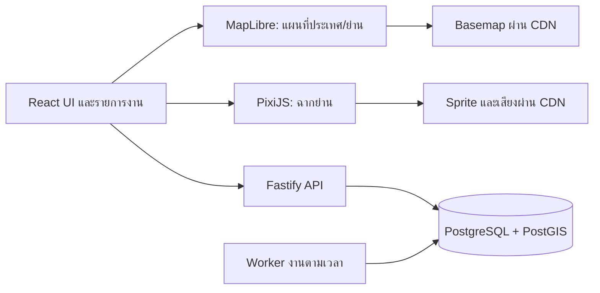

# Technical Direction & Prototype Plan

วันที่: 14 ตุลาคม 2569 (2026-10-14)  
สถานะ: Proposed — เลือกเพื่อทำต้นแบบและวัดผล ยังไม่มีการติดตั้งหรือ benchmark  
อ้างอิง: [GDD](../game_design_document.md) · [Thailand research](thailand_research.md)

## 1. เป้าหมายและสมมติฐานด้านทีม

สมมติเริ่มจากผู้สร้างคนเดียวทำงานร่วมกับ coding agent หรือทีมเล็ก ต้องการต้นแบบบนมือถือก่อน ไม่ได้ตั้งสมมติฐานว่ามีทีม MMO, 3D artists หรือ operations ตลอด 24 ชั่วโมง งบจริงยังไม่ทราบ จึงยังไม่จองบริการหรือกำหนดคำมั่นค่าใช้จ่าย

โครงสร้างต้องรองรับการเล่นแบบไม่พร้อมเวลา, ความถูกต้องของ inventory, พื้นที่ข้อมูลน้อย และการดูแลชุมชน โดยเพิ่มบริการเท่าที่มีภาระงานจริง

## 2. Stack ที่แนะนำ

| ส่วน | ข้อเสนอ | เหตุผลและขอบเขต |
|---|---|---|
| Client | React + TypeScript + Vite | UI เกมเป็น client app; เริ่มจาก SPA ที่แบ่งโหลดตามหน้าจอ ไม่ต้องทำ SSR สำหรับฉากเกม [S1] |
| UI | CSS variables + CSS modules, DOM สำหรับเมนู/งาน/การเข้าถึง | มี theme กลางและ list view; ไม่ต้องนำ UI framework ขนาดใหญ่มาก่อนรู้รูปแบบเกม |
| แผนที่ | MapLibre GL JS | แสดง vector basemap และ game markers; ต้องมีแหล่ง tiles แยก ไม่ใช่บริการข้อมูลแผนที่ในตัว [S2] |
| ฉากย่าน | PixiJS v8, เลือก WebGL เป็น baseline เริ่มต้น | เหมาะกับฉาก 2D/sprite; ทดสอบอุปกรณ์จริง ไม่สมมติว่าใส่ renderer เพิ่มแล้วเร็วขึ้น [S3] |
| API / game rules | Node.js LTS + TypeScript + Fastify | บริการเดียวแยกโมดูลบัญชี โลก งาน เศรษฐกิจ ชุมชน ไม่แยก microservices ใน MVP [S4] |
| ฐานข้อมูล | PostgreSQL + PostGIS, ใช้ managed Supabase เป็นตัวเลือกเริ่มต้น | relational transactions สำหรับของ/รางวัล และ spatial index สำหรับข้อมูลแผนที่ [S5] |
| Login | Supabase Auth | ใช้ระบบบัญชีที่มีอยู่; เริ่ม provider ที่ตั้งค่าทดสอบได้จริงและทดสอบ flow มือถือ [S6] |
| Static assets / basemap | Object storage + CDN; PMTiles สำหรับชุด basemap ที่มีสิทธิ์และจัดเตรียมแล้ว | แยกข้อมูลคงที่ออกจาก state เกมที่เปลี่ยนบ่อย [S7] |
| Sync | HTTP snapshot หลัง mutation + polling เมื่อหน้าเปิด | เพียงพอสำหรับ asynchronous play; เพิ่ม scoped realtime channel เมื่อมีเหตุผลจาก UX และ load |
| Jobs | ตารางงานใน Postgres + worker จาก codebase เดียวกับ API | รองรับ retry/lease/idempotency โดยไม่ต้องมี Redis ตั้งแต่ต้น |
| Tests | Unit/domain tests, PostgreSQL integration tests, Playwright browser flows | ทดสอบกติกาและการเล่นจริง โดยเฉพาะหลายบัญชี/หลายแท็บ/เน็ตหลุด |
| Deployment | Static client + API/worker container + managed DB ใน region ใกล้ผู้เล่นที่วัด latency ได้ | ผู้ให้บริการและ plan ตัดสินหลังได้งบ/ผลวัด; ไม่เลือกเพียงเพราะมี free tier |

เวอร์ชัน exact ต้องเลือกจาก release ที่รองรับกัน ณ วันที่เริ่มลงมือ และ pin ใน lockfile ไม่เรียกคำว่า latest ในเอกสารนี้เป็นสัญญาระยะยาว

### ทางเลือกที่พิจารณาแล้ว

- **Mapbox/Google Maps:** ประเมินได้หากคุณภาพข้อมูล การค้นหา หรือบริการที่ต้องใช้คุ้มกับเงื่อนไขและค่าใช้จ่าย แต่ MVP ไม่ควรล็อก game state กับ provider ใด ต้องตรวจราคาปัจจุบันก่อนเลือก ไม่อ้างว่า MapLibre ทำให้ map hosting ฟรี
- **Phaser:** พิจารณาแทน PixiJS ถ้าต้นแบบกลายเป็นเกมมี movement/collision/minigames หนัก; ขณะนี้เน้นฉาก ปฏิสัมพันธ์ และ UI
- **Unity/Godot/native:** ยังไม่จำเป็นกับ vertical slice ที่วางไว้ ถ้าต้องใช้ world simulation, 3D หนัก หรือข้อจำกัด browser กระทบการเล่นจริง ค่อยทบทวนด้วย prototype เดียวกัน
- **API บน Supabase functions/RPC ทั้งหมด:** ลดจำนวนบริการได้ แต่เลือก Node API เพื่อให้ game rules และ simulation tests อยู่ที่เดียว; SQL ทำหน้าที่รักษา atomicity และ constraints ไม่เขียนกติกาซ้ำสองชุด
- **Redis/Socket.io/Go/Kubernetes:** ยังไม่มีหลักฐานว่าจำเป็น ไม่เพิ่มเพียงเพราะอยู่ใน GDD เดิม

## 3. ขอบเขต renderer

Map view และ scene view เป็นหน้าสลับกัน ไม่ซ้อน MapLibre + Three.js + PixiJS ทั้งหมดตลอดเวลา Pause animation ของหน้าที่ซ่อนและคืน resource ตาม memory budget; ถ้าอุปกรณ์รับไม่ไหวให้ใช้ฉากภาพนิ่งและ DOM interaction ที่ยังเล่นได้

MapLibre เป็นตัวแสดงแผนที่ที่อ่าน tiles ไม่ได้ให้ฐานข้อมูลตึก/POI โดยตัวมันเอง PixiJS ไม่ได้เป็นเครื่องพิสูจน์ความถูกต้องของ game state และไม่ได้รับประกัน Canvas fallback สำหรับ stack นี้ ต้องทำ fallback UI แยก

## 4. ข้อมูลแผนที่และขอบเขตประเทศ

### 4.1 ชั้นข้อมูล

1. **Basemap:** ถนน แม่น้ำ ชื่อพื้นที่ และองค์ประกอบที่อนุญาต จาก OSM-derived tiles หรือชุดที่จัดเตรียมเอง
2. **Place index:** รายการจังหวัด/อำเภอ/ย่านพร้อม stable id, ชื่อไทย, geometry, source, version; ใช้ค้นหาภายในเกม
3. **Game locations:** จุดอ้างอิงของย่านเสมือน มี `fictional=true` เมื่อเป็นจุดเกม ไม่ปลอมเป็น POI จริง
4. **Community state:** กลุ่ม โครงการ คำขอ และ layout เก็บในฐานข้อมูลเกม ไม่แก้ OSM และไม่เก็บในไฟล์ basemap

OSM เป็นข้อมูลภายใต้ ODbL ต้องตรวจ attribution และเงื่อนไขข้อมูลที่นำมาปรับ/เผยแพร่ แยกแหล่งที่มาและชุดข้อมูลเกมอย่างชัดเจน แต่การแยกตารางอย่างเดียวไม่ใช่ข้อสรุปทางกฎหมายว่าไม่มีภาระ share-alike ต้องตรวจรูปแบบการใช้จริงก่อนเผยแพร่ [S8]

Geofabrik มี Thailand extract ให้เป็นวัตถุดิบ แต่ต้องมี preprocessing, tile schema, style, fonts/glyphs และกระบวนการ update ที่เข้ากัน ไม่ส่งไฟล์ประเทศทั้งก้อนไป browser และไม่ใช้ experimental tileset เป็น production contract โดยไม่ตรวจ [S9]

### 4.2 ทางเริ่มต้นแบบ

- P0 ใช้ fixture สองพื้นที่และข้อมูลตัวอย่างที่ติดป้ายชัด ทดลอง core loop ก่อน pipeline ประเทศ
- P1 ใช้ basemap ที่มีสิทธิ์ให้บริการพื้นที่ตัวอย่าง และ place index ที่ตรวจชื่อแล้ว; ไม่ claim coverage ทั่วไทย
- P3 จึงจัดทำ/เลือก basemap ประเทศ ทำ attribution และ place index, ลง version, ตรวจ coverage ก่อน public beta
- ถ้าเลือก PMTiles: เป็น archive อ่านอย่างเดียว ใช้ HTTP Range requests และต้องตรวจ CORS/CDN/range caching จริง การอัปเดตใช้ไฟล์ version ใหม่ ไม่เขียนสถานะบ้านลงไปในนั้น [S7]
- เส้นทางใน MVP เป็นเส้นเชื่อมแบบเกมและ distance band ไม่อ้างว่าเป็นเส้นทางเดิน/ขับจริง หากต้องการ road routing ภายหลังประเมินข้อมูลและ routing engine แยก

### 4.3 ไม่พึ่ง endpoint ฟรีเป็น infrastructure ของเกม

นโยบาย `tile.openstreetmap.org` ระบุความจุจำกัด ไม่มี SLA และห้าม bulk download/offline prefetch จึงไม่ใช้เป็นฐาน production หรือดาวน์โหลดทั้งประเทศผ่าน endpoint นี้ [S10]

Public Nominatim มีเพดานรวม 1 request/วินาทีต่อ application และห้าม client autocomplete จึงใช้ place index ภายในสำหรับค้นย่านใน MVP; หากต้อง geocode จริงให้เลือกผู้ให้บริการหรือ self-host ที่มีเงื่อนไขเหมาะสม [S11]

### 4.4 Coverage contract

การสร้างย่านรับ `place_id` หรือจุดอ้างอิงที่ resolve เข้าพื้นที่บริการได้ ใช้ stable `game_location_id` ไม่ใช้ชื่อพื้นที่เป็น primary key

ทุกย่านมี station พื้นฐานครบโดย deterministic template + content version แม้ POI ไม่พบ การ update basemap ต้องไม่ทำให้บ้านหาย เปลี่ยนกติกาผลผลิต หรือเปลี่ยน ID ของชุมชน

ยังไม่เลือก H3 เป็นข้อบังคับ สามารถเพิ่ม spatial cells หากการค้นใกล้เคียงหรือโหลดแผนที่จำเป็นจริง ตอนนี้ PostGIS + stable area ids เพียงพอสำหรับออกแบบต้นแบบ ต้องตรวจ CRS และใช้หน่วยระยะทางถูกต้อง ไม่คำนวณกิโลเมตรจากองศาตรง ๆ

## 5. โมเดลข้อมูลและ invariants

| Entity | หน้าที่และกติกาสำคัญ |
|---|---|
| Account / Profile | Auth id แยกจากชื่อแสดง; profile สาธารณะมีเฉพาะฟิลด์ที่ตั้งใจเปิด |
| Place / GameLocation | ภูมิศาสตร์อ้างอิงและฉากเกมแยกกัน; ไม่เก็บที่อยู่จริงจากการเลือกบ้าน |
| PlayerHome | ทรัพย์สินส่วนตัว ไม่โอนให้หัวหน้าชุมชน |
| RoleProgress | ค่าฝีมือต่อบทบาท; เปลี่ยนบทบาทไม่รีเซ็ต |
| Inventory / Ledger | หน่วยเป็น integer; ยอดไม่ติดลบ; ทุก grant/consume มีเหตุและ idempotency id |
| WorkOrder | input ที่กันไว้, output ตาม recipe version, start/ready time จาก server, state machine |
| Delivery / Request | ผู้สร้าง ผู้รับ เงื่อนไข รางวัล และสถานะส่งมอบ; รับซ้ำไม่ได้ |
| Community / Membership | หนึ่งชุมชนหลักต่อบัญชีใน MVP; สิทธิ์อ่าน/เขียนตรวจทุกครั้ง |
| Project / Contribution | ส่งมอบแล้วใช้ของและอัปเดต progress ใน transaction เดียว; รางวัลช่วงจ่ายครั้งเดียว |
| ItemProvenance / Memory | ข้อมูลผู้มีส่วนร่วมแบบย่อและตามสิทธิ์; ความทรงจำไม่ใช่ inventory สำเนา |
| ModerationReport / Action | block/report, เหตุผลจัดการ, audit trail และสิทธิ์ผู้ดูแล |
| OutboxEvent | แจ้งเตือน/อัปเดต feed หลัง transaction สำเร็จ; retry แล้วไม่ส่งผลเศรษฐกิจซ้ำ |

เซิร์ฟเวอร์เป็นผู้ตัดสินจำนวนของ รางวัล เวลา สูตร สิทธิ์ และ progress ของโครงการ Client ส่งเจตนา เช่น `start_work` หรือ `deliver` ไม่ส่งค่ากำไรที่ต้องเชื่อ

## 6. Atomicity และตัวอย่าง flow

### เริ่มงาน

1. ตรวจ session, สิทธิ์, recipe version, ขีดจำกัดคิวรวม และ idempotency key
2. ใน transaction เดียว lock แถวที่เกี่ยวข้อง ตรวจวัตถุดิบ หัก/กัน input และสร้าง work order
3. ตั้ง `ready_at` จากเวลาฝั่ง server และ duration ที่ตกลงตอนเริ่ม
4. ส่งสถานะที่ commit แล้วให้ client พร้อมเวลาของ server

### รับงาน/ส่งมอบ

1. ตรวจว่า ready หรือยัง โดยไม่เชื่อเวลาบนเครื่อง
2. เปลี่ยน state ตามเงื่อนไขใน transaction ที่ป้องกัน concurrent requests
3. ออก ledger entry, grant/consume item และ contribution ใน transaction เดียว
4. ใช้ unique constraint ต่อ work/reward/stage กันการรับซ้ำจากหลายแท็บและ worker retry
5. เขียน outbox event แล้วค่อยให้ worker ส่ง feed/notification

งานทั่วไปคำนวณผลเมื่อเปิดดูหรือขอรับได้ ไม่ต้องตั้ง timer หนึ่งตัวต่อผู้เล่น Worker ใช้กับงานร่วม/การปิดช่วง/แจ้งเตือน และใช้ lease กับ retry ที่ปลอดภัย งานพร้อมรับยังคงพร้อมแม้ worker ล่าช้า

โครงการที่รับ contribution เกินเป้าจากคำขอพร้อมกันต้องยอมรับเพียงส่วนที่ยังขาดหรือคืนของตามกติกาที่แสดงไว้ ไม่กลืนของส่วนเกิน ผลซ้ำจาก network retry คืนผลเดิม การคืนของจากความผิดพลาดใช้ compensating ledger พร้อมเหตุผล ไม่แก้ยอดเงียบ ๆ

## 7. บัญชีและสิทธิ์เข้าถึง

- Guest preview เป็น sandbox ไม่เชื่อ state จาก localStorage ในเศรษฐกิจร่วม ผู้ใช้สมัครแล้วเริ่ม state ที่ server รับรองหรือ replay เฉพาะ tutorial ที่ตรวจได้
- API ตรวจ token ตามกลไกของ provider และ authorization ของทุก resource ไม่ใช้เพียงว่าล็อกอินแล้ว
- ไม่ส่ง service role key ไป browser ข้อมูลเกมที่มีมูลค่าห้าม client เขียนโดยตรง
- ตารางที่เปิดผ่าน Supabase Data API ต้องมี RLS และ policy ตามสิทธิ์; พิจารณาปิดการ expose schema เกมที่ไม่ต้องใช้ ข้อควรทราบ: service-role/privileged connection อาจข้าม RLS จึงยังต้องตรวจสิทธิ์ใน API [S12]
- เก็บ inventory/ledger ด้วย SQL transaction ไม่อาศัยหลาย REST calls ว่าจะสำเร็จพร้อมกัน
- จำกัด burst ของ mutation, การสร้างบัญชี และการสร้างชุมชนโดยไม่บังคับเก็บเลขบัตรหรือยืนยันอาชีพจริง
- ลิงก์ชวนไม่มี token ล็อกอินผู้ส่ง มีขอบเขตสิทธิ์/ยกเลิกได้; รายละเอียดกลุ่มปิดไม่รั่วผ่าน preview

การปั๊มหลายบัญชีแก้ไม่จบด้วย IP block เดียว ต้องใช้ข้อจำกัดการโอน ระบบคำขอที่มีงบชัด และการตรวจรูปแบบรางวัลผิดปกติ MVP ไม่เปิดตลาดอิสระเพื่อลดพื้นที่โจมตี

## 8. เป้าประสิทธิภาพสำหรับทดสอบ

ตัวเลขทั้งหมดเป็น **engineering budgets ที่เสนอ ไม่ใช่ผลวัดแล้ว** ทบทวนหลัง P1 และระบุเครื่องจริง/เครือข่ายในผลทดสอบ

| รายการ | เป้าเริ่มต้น |
|---|---|
| Tutorial มีปุ่มแรกที่กดได้ | ไม่เกิน 5 วินาทีบน Android RAM 4 GB และ profile ทดสอบ 10 Mbps / RTT 150 ms |
| ข้อมูลดาวน์โหลด session แรก | ไม่เกิน 8 MB แบบ compressed สำหรับเข้า tutorial และฉากแรกหนึ่งพื้นที่; รวม font/sprite/tile ที่ต้องใช้ ไม่โหลดประเทศทั้งก้อน |
| ฉากโหมดประหยัด | เฟรมส่วนใหญ่ภายใน 33 ms; ทดสอบ 10 นาทีและตอนสลับ map/scene |
| Mutation API | p95 ไม่เกิน 700 ms ภายใต้ load alpha ที่จำลองและระบุจริง แยก network latency |
| แผนที่/scene ล้มเหลว | กลับไป list UI ที่เล่นหลักได้ พร้อมบอกปัญหา; ไม่ fake success |
| เศรษฐกิจ | ไม่มี item ซ้ำ/ติดลบ/รับรางวัลซ้ำใน concurrency และ retry tests |

ต้องวัดอย่างน้อย Android ระดับเริ่มต้นและกลาง, Safari บน iPhone ที่อยู่ใน support matrix, desktop browser และ browser ภายในแอปที่ผู้ทดสอบเปิดลิงก์บ่อย หาก in-app browser มีปัญหาต้องมีทางเปิด browser ปกติและไม่ทำ progress สูญหาย

Net offline: อ่านสถานะ cached ที่ติดป้ายเวลาได้ แต่ไม่รับเงิน/ส่งของสำเร็จเอง เมื่อกลับมา online ให้ fetch authoritative snapshot และตรวจ pending command โดย idempotency key ไม่ queue ธุรกรรมจำนวนมากโดยไม่ให้ผู้เล่นรู้

PWA ไม่รับประกัน background execution หรือการแจ้งเตือนทุกแพลตฟอร์ม Notifications เป็น optional enhancement และไม่เป็นเงื่อนไขเล่นได้

## 9. ลำดับการสร้าง thin slices

| Slice | สร้าง | ตรวจอะไร |
|---|---|---|
| A — Fun prototype | React UI + ฉากตัวอย่าง + กติกาบริสุทธิ์ 2 บทบาท; ยังไม่ใช้เศรษฐกิจร่วม | ความเข้าใจ ทางเลือก และผลที่เห็น ก่อนลงทุน backend เต็ม |
| B — Map connection | MapLibre + place fixtures + เข้า/ออกฉากและเส้นทางเกม | แผนที่มีผลจริง; ไม่มี GPS/ไม่มี POI ยังเล่นได้ |
| C — Saved personal loop | Auth + API + inventory/ledger/work orders + offline completion | เวลา server, retry, หลายแท็บ, refresh และเน็ตหลุด |
| D — Four roles | ครบ 4 บทบาทโดยใช้คิวเดียวและ recipe versions | ไม่มีบทบาทเป็นเพียง reskin และไม่มีช่องปั๊มคิวจากการสลับ |
| E — Shared project | ชุมชน คำขอ ส่งมอบ credit และ project stages | สองคนต่อยอดกันจริง; คนเดียวไม่ตัน; concurrent contributions ถูกต้อง |
| F — Safe alpha | report/block, moderation tools, telemetry, backup/restore, consent flows | พร้อมรับผู้ทดสอบภายนอกและแก้ปัญหาได้ |
| G — Coverage beta | basemap/place pipeline ประเทศ, fixtures 77 พื้นที่, จุดชายขอบและ performance | พิสูจน์ขอบเขตบริการก่อนประกาศทั่วไทย |

ไม่ประมาณเสร็จในกี่สัปดาห์ก่อนรู้ขนาด art/content และผล slice A การทำแต่ละ slice จบต้องมีสิ่งให้เล่น/ตรวจได้ ไม่ขยาย framework หลายเดือนก่อนมี loop

## 10. การทดสอบที่จำเป็นก่อน alpha

- เริ่มงานเดียวกันสองครั้งจากสองแท็บ: หัก input และสร้าง output ตามขีดจำกัดที่ถูกต้อง
- รับผลซ้ำหลัง timeout: ได้ผลเดิม ไม่มี grant ซ้ำ
- เปลี่ยนนาฬิกาเครื่อง: ไม่ทำให้งานเสร็จเร็วหรือผลผลิตเพิ่ม
- คนสองคนเติมโครงการช่วงสุดท้ายพร้อมกัน: ไม่เกินเพดาน ไม่กลืนของ ไม่แจกรางวัลสองรอบ
- ออกจากชุมชนระหว่างส่งมอบ: กติกาการยอมรับ/ปฏิเสธชัด ของไม่หาย และไม่มีสิทธิ์ใช้ resource ของกลุ่มเก่าหลังออก
- เปลี่ยน role ตอนมีงาน: ไม่เพิ่มคิว ไม่เปลี่ยน recipe ที่ล็อกไว้
- ผู้ใช้ A อ่าน/เขียนของ B หรือเห็นกลุ่มปิด: ปฏิเสธทั้ง API และ Data API ที่เปิดไว้
- Worker crash ก่อน/หลัง commit: retry ปลอดภัย outbox ไม่ทำเศรษฐกิจซ้ำ
- ย่านไม่มี POI หรือ map tiles ล้ม: tutorial และงานหลักยังทำได้ผ่าน fallback
- Version basemap เปลี่ยน: บ้าน/ชุมชนอ้างอิง ID เดิมและความก้าวหน้าไม่หาย
- 1, 8, 20 คนในชุมชน: ไม่มีจำนวนสมาชิกขั้นต่ำแอบแฝง และการเพิ่มคนไม่เพิ่มรางวัลส่วนตัวแบบไม่จำกัด
- Report/block: ช่องทางติดต่อและการแสดงโปรไฟล์ที่เกี่ยวข้องหยุดตามขอบเขตโดยไม่ลบร่องรอยหลักฐาน

เศรษฐกิจต้องมี simulation ของ sources/sinks และการเล่น 1/7/30 วันก่อน public beta ผล simulation เป็นหลักฐานกติกา ไม่แทน playtest ว่าสนุก

## 11. การวัดผลและดูแลระบบ

Events ขั้นต่ำ: `tutorial_started`, `first_work_completed`, `role_switched`, `work_delivered`, `project_stage_completed`, `human_contribution_used`, `community_joined`, `map_failed`, `fallback_used`, `report_created`

แยก `actor_type=player|npc|staff_test` และเหตุเริ่ม session จาก reminder/test assignment เมื่อทราบ ไม่ใส่ exact GPS ข้อความส่วนตัว หรือ token ใน analytics/logs เก็บเฉพาะข้อมูลที่มีวัตถุประสงค์และกำหนด retention ก่อนเก็บจริง

ติดตาม API errors/latency, failed jobs, ledger invariants, map bandwidth, context loss, การส่งซ้ำ, คิวรายงาน และการกลับมาของผู้เล่น แสดง diagnostics ในเครื่องมือผู้ดูแล ไม่ใส่รายละเอียด server ใน flow ผู้เล่น

มี feature flag ปิดส่งของ/โครงการใหม่เมื่อเศรษฐกิจผิดปกติ โดยยังอ่านบ้านได้ สำรอง DB และทดลอง restore ในสภาพแวดล้อมทดสอบก่อน alpha เก็บ asset/content versions เพื่อย้อนกลับโดยไม่ใช้สูตรใหม่กับงานเก่ากลางทาง

## 12. ต้นทุนและเงื่อนไขก่อนเปิดบริการ

ยังไม่ให้ราคาผู้ให้บริการเป็นตัวเลข เพราะไม่มี load ที่วัดและยังไม่ได้เลือก plan สูตรประเมิน:

`ต้นทุนรายเดือน = DB/backup + API/worker + storage/CDN/map requests + auth/email + monitoring + คนดูแลชุมชน + art/content`

ทดสอบสถานการณ์ 100 / 1,000 / 10,000 DAU เป็นเพียง scenario ไม่ใช่คำรับรอง scale เก็บ bytes ต่อ session, API calls ต่อ session, จำนวนงานต่อคน, peak concurrency และเวลาตรวจรายงาน แล้วเทียบราคาจริง ณ วันที่เลือกผู้ให้บริการ

งานที่ไม่หายไปเพราะมี coding agent: ตรวจวัฒนธรรม/สิทธิ์งานศิลป์, หา playtesters, ตัดสินใจบาลานซ์, moderation, บัญชีผู้ให้บริการ, การชำระเงิน และนโยบายบริการ ต้องมีเจ้าของความรับผิดชอบก่อนเปิดสาธารณะ

## 13. แหล่งเทคนิคที่ตรวจ

ทุกลิงก์เป็นแหล่งทางการ ตรวจเมื่อ 14 ตุลาคม 2569; เอกสารอาจเปลี่ยน ต้องตรวจ compatibility และเงื่อนไขอีกครั้งตอน implement

- **S1:** [Vite Getting Started](https://vite.dev/guide/)
- **S2:** [MapLibre GL JS](https://maplibre.org/projects/gl-js/)
- **S3:** [PixiJS Renderers](https://pixijs.com/8.x/guides/components/renderers)
- **S4:** [Fastify documentation](https://fastify.dev/docs/latest/)
- **S5:** [Supabase PostGIS](https://supabase.com/docs/guides/database/extensions/postgis) และ [PostGIS documentation](https://postgis.net/documentation/)
- **S6:** [Supabase Auth](https://supabase.com/docs/guides/auth)
- **S7:** [PMTiles Concepts](https://docs.protomaps.com/pmtiles/)
- **S8:** [OpenStreetMap copyright and licence](https://www.openstreetmap.org/copyright)
- **S9:** [Geofabrik Thailand extract](https://download.geofabrik.de/asia/thailand.html)
- **S10:** [OSMF Tile Usage Policy](https://operations.osmfoundation.org/policies/tiles/)
- **S11:** [OSMF Nominatim Usage Policy](https://operations.osmfoundation.org/policies/nominatim/)
- **S12:** [Supabase Row Level Security](https://supabase.com/docs/guides/database/postgres/row-level-security)
